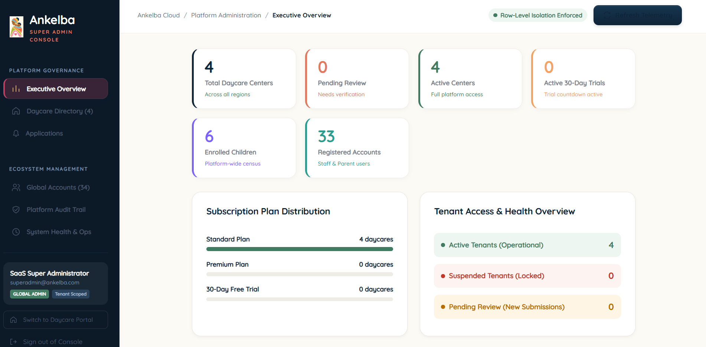
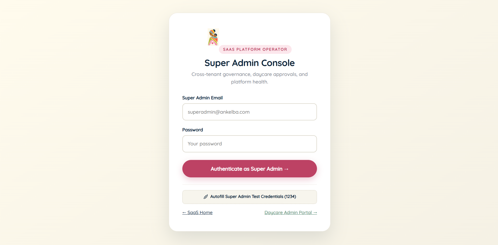
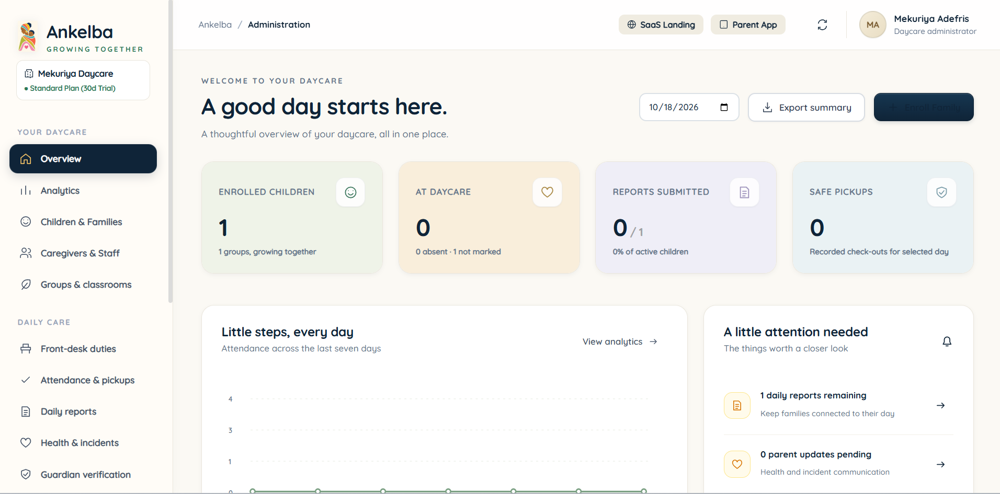
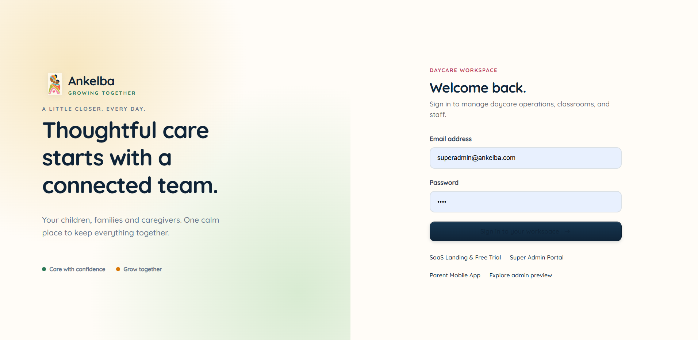
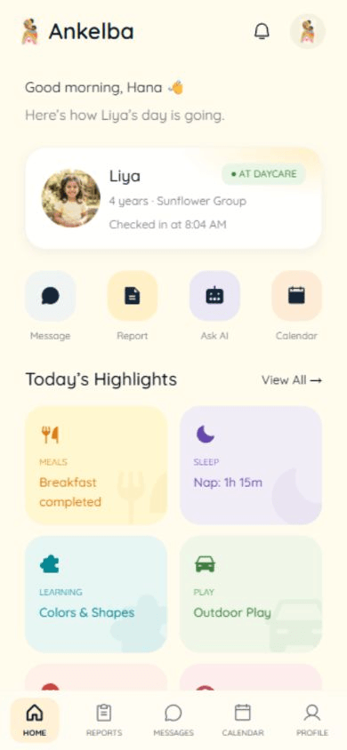
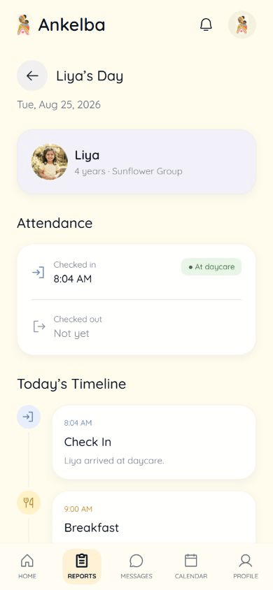
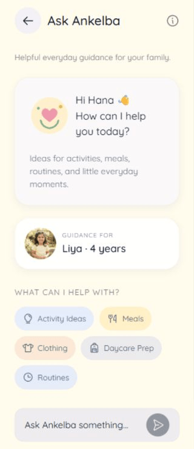
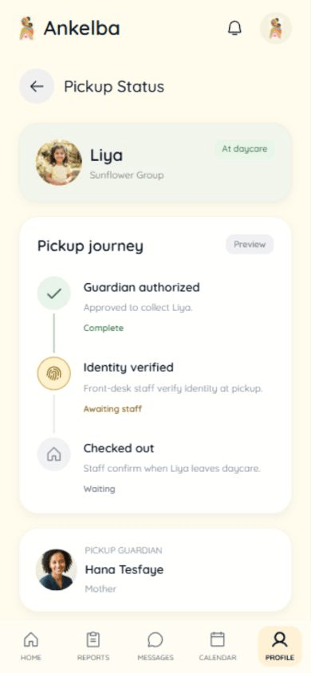
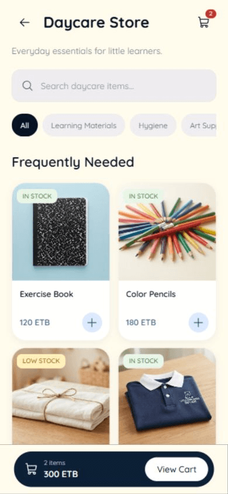
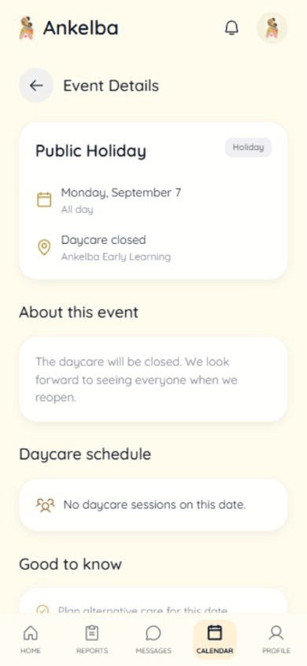

# Ankelba (አንከልባ) 👶✨

> **Parent Communication, Child Activity Reporting & Multi-Tenant SaaS Platform for Daycare Centers**  
> *HiLCoE — School of Computer Science and Technology | Senior Project 2026*  
> **Prepared by:** Arsema Alemayehu, Helina Fikru, Melat Hailu, Mistire Tilahun  

---

[](https://nodejs.org/)
[](https://www.postgresql.org/)
[](https://reactnative.dev/)
[](https://www.typescriptlang.org/)
[](#multi-tenant-saas-architecture)
[](#credits--academic-acknowledgments)

---

## 🌟 Table of Contents
1. [📸 System Screenshots & UI Walkthrough](#-system-screenshots--ui-visual-walkthrough)
2. [Overview & Problem Statement](#-overview--problem-statement)
3. [Key Capabilities & Modules](#-key-capabilities--modules)
4. [Multi-Tenant SaaS Architecture](#-multi-tenant-saas-architecture)
5. [User Roles & Workspaces](#-user-roles--workspaces)
6. [Technology Stack](#-technology-stack)
7. [Design System — UI/UX Pro Max](#-design-system--uiux-pro-max)
8. [Getting Started & Local Setup](#-getting-started--local-setup)
   - [Prerequisites](#prerequisites)
   - [Backend Configuration](#1-backend-setup)
   - [Frontend Configuration](#2-frontend-setup)
9. [Testing & Quality Assurance](#-testing--quality-assurance)
10. [Project Directory Structure](#-project-directory-structure)
11. [Security, Privacy & Compliance](#-security-privacy--compliance)
12. [Credits & Academic Acknowledgments](#-credits--academic-acknowledgments)

---

## 📸 System Screenshots & UI Visual Walkthrough

> **👀 Checkout the system preview first before running!**  
> Below is a visual walkthrough of the Ankelba platform across all user roles: Super Admin console, Daycare Admin portal, Front-Desk Caregiver workspace, and the Parent Mobile Application.

### 🏢 1. Platform Governance & Daycare Portals (Web)

| Super Admin Management Console | Super Admin Operator Login |
| :---: | :---: |
|  |  |
| *Cross-tenant governance, daycare approvals, and system telemetry* | *Dedicated platform operator authentication* |

| Daycare Administrator Dashboard | Portal & Staff Authentication |
| :---: | :---: |
|  |  |
| *Real-time child attendance, classroom groups, and revenue analytics* | *Role-based login for administrators, staff, and parents* |


### 📱 2. Parent Mobile Application (React Native / iOS & Android)

| Parent Home & Daily Routine | Comprehensive Activity Report | 24/7 AI Parent Guide |
| :---: | :---: | :---: |
|  |  |  |
| *Real-time child activity timeline* | *Structured meal, nap, potty & mood logs* | *Evidence-based parenting recommendations* |

| Biometric Guardian Pickup | Daycare Store & Chapa Payments | Community Events Calendar |
| :---: | :---: | :---: |
|  |  |  |
| *Adult identity verification at checkout* | *Uniforms, hygiene supplies & digital checkout* | *Field trips, holidays & conferences* |

---

## 📖 Overview & Problem Statement

Modern daycare centers often struggle with fragmented communication, manual paper-based logs, attendance discrepancies, and security challenges during child pickup. Parents experience anxiety due to lack of visibility into their child's daily nutrition, nap schedules, and developmental milestones.

**Ankelba** solves these challenges by providing a unified, secure, and modern platform that connects daycare administrators, teachers/caregivers, and parents in real time. Built from the ground up as a multi-tenant cloud SaaS platform, Ankelba allows daycare centers to register, launch 30-day trials, manage classrooms, and operate with strict row-level database tenant isolation.

---

## 🚀 Key Capabilities & Modules

### 1. 🛡️ Attendance & Biometric Guardian Pickup
- **Daily Check-In & Check-Out:** Caregivers mark presence with timestamps and group tracking.
- **Biometric Guardian Verification:** Authorized adult guardians enroll reference credentials to verify their identity during pickup.
- **Controlled Manual Fallback:** Secure administrative fallback protocol with mandatory identity notes when biometric sensors are unavailable.

### 2. 📝 Comprehensive Daily Activity Reporting
- **Structured Activity Logs:** Real-time logging of meals/feeding, nap durations, diaper/potty changes, learning activities, and emotional moods.
- **Care Instructions & Safety Flags:** Immediate alerts for allergies, medications, and specific care instructions to ensure safety.

### 3. 🤖 24/7 AI Parent Guide
- **Pediatric Routine Support:** AI assistant offering evidence-based parenting guidance on toddler routines, sleep transitions, developmental milestones, and daycare preparation.
- **Strict Privacy Boundaries:** Data minimization safeguards ensuring child records remain confidential and medical diagnoses are never rendered.

### 4. 🛒 Daycare E-Commerce & In-App Payments
- **Daycare Essentials Store:** Daycares can list uniforms, learning materials, hygiene products, and event tickets.
- **Flexible Checkout:** Integrated with **Chapa** (Ethiopian digital payment gateway) alongside a **Pay at Daycare** workflow.

### 5. 📅 Simple Events & Calendar
- **Community Calendar:** Centralized schedules for parent-teacher conferences, national holidays, field trips, and center closing dates.

### 6. 🚨 Emergency Communication & Broadcast Alerts
- **Real-Time Notifications:** Direct messaging between parents and assigned teachers, group announcements, and urgent center-wide alerts.

---

## 🏢 Multi-Tenant SaaS Architecture

Ankelba utilizes a **Row-Level Multi-Tenancy** architecture with strict `daycare_id` database scoping:

```
                          ┌───────────────────────────┐
                          │   Super Admin Operator    │
                          │ (Onboarding, Audits, KPIs)│
                          └─────────────┬─────────────┘
                                        │
        ┌───────────────────────────────┴───────────────────────────────┐
        ▼                                                               ▼
┌───────────────────────────────┐               ┌───────────────────────────────┐
│     Daycare Center Tenant A   │               │     Daycare Center Tenant B   │
│   (Staff, Children, Groups)   │               │   (Staff, Children, Groups)   │
└───────────────┬───────────────┘               └───────────────┬───────────────┘
                │                                               │
    ┌───────────┴───────────┐                       ┌───────────┴───────────┐
    ▼                       ▼                       ▼                       ▼
Caregiver Web         Parent Mobile           Caregiver Web         Parent Mobile
```

- **Zero Cross-Tenant Leakage:** All operational tables (`children`, `guardians`, `attendance`, `reports`, `duties`, `orders`, `events`) are scoped by `daycare_id`.
- **Automated 30-Day Trials:** Daycares register directly via the SaaS landing page with automatic 30-day trials upon Super Admin review.
- **Platform Health Monitoring:** Super Admin dashboard tracks database latency, active trials, and system audit trails.

---

## 👥 User Roles & Workspaces

| Role | Interface | Key Responsibilities |
|---|---|---|
| **Super Administrator** | Dedicated Web Console (`/super-admin`) | Platform governance, approving daycare registrations, subscription lifecycle, platform metrics, and global audit logging. |
| **Daycare Administrator** | Daycare Web Portal (`/admin`) | Staff assignments, caregiver hiring, child & parent enrollment wizard, duty roster, events, store inventory, and billing. |
| **Caregiver / Teacher** | Front-Desk Web Workspace (`/staff`) | Daily child check-in/out, guardian pickup verification, health reports, daily logs, and parent communication. |
| **Parent / Guardian** | Mobile App (iOS / Android / Web) | Viewing real-time child activity feeds, attendance history, AI parenting guidance, emergency contacts, and daycare store orders. |

---

## 💻 Technology Stack

### Backend
- **Runtime:** Node.js 20 LTS
- **Framework:** Express.js
- **Database:** PostgreSQL 15+
- **Database Migrations:** Knex.js (versioned transactional schema migrations)
- **Authentication:** JWT with HttpOnly cookies, session revocation, and bcryptjs hashing
- **Validation:** Joi schema validation
- **Logging:** Winston + Morgan HTTP logger

### Frontend & Mobile
- **Core:** React 18, React Native, Expo SDK
- **Language:** TypeScript
- **Styling:** Vanilla CSS Pro Max Design System (clean tokens, zero bulky UI library bloat)
- **Vector Icons:** Phosphor / Feather SVG vector suite
- **Navigation:** React Navigation (Native Stack + Bottom Tabs) + Web PopState routing

---

## 🎨 Design System — UI/UX Pro Max

The platform features a **Pro Max Design System** tailored for childcare ergonomics and professional administrative governance:

- **Curated Warm Palette:** Deep Navy (`#0F2438`), Emerald Green (`#2D7A58`), Warm Cream (`#FFFCF7`), Golden Amber (`#D97706`), and Coral (`#E06D53`).
- **Glassmorphism & Depth:** Frosted glass backdrops (`backdrop-filter: blur(14px)`), smooth entry animations, and multi-tier ambient shadows.
- **Accessible Typography (WCAG 2.2):** Calibrated readable text sizes (13px body, 11px uppercase tracking labels), minimum 40px touch targets, and high-contrast pill status badges.
- **Micro-Interactions:** Tactile button presses (`transform: scale(0.98)`), hover lifts, and real-time status pills.

---

## 🛠️ Getting Started & Local Setup

### Prerequisites
- **Node.js:** v20.x or later ([Download Node.js](https://nodejs.org/))
- **PostgreSQL:** v15 or later ([Download PostgreSQL](https://www.postgresql.org/download/))
- **Git**

---

### 1. Backend Setup

1. **Navigate to the backend directory:**
   ```bash
   cd backend
   ```

2. **Install dependencies:**
   ```bash
   npm install
   ```

3. **Configure environment variables:**
   ```bash
   cp .env.example .env
   ```
   *Edit `.env` with your PostgreSQL database credentials and JWT secrets.*

4. **Initialize the database:**
   ```sql
   -- Run in your PostgreSQL client (psql):
   CREATE DATABASE ankelba_dev;
   ```

5. **Run database migrations:**
   ```bash
   npx knex migrate:latest --knexfile src/config/knexfile.js
   ```

6. **Seed demo data (Optional):**
   ```bash
   node scripts/seed_demo_accounts.js
   node scripts/seed_parent_data.js
   ```

7. **Start the backend server:**
   ```bash
   node server.js
   # Server runs on http://localhost:5000
   ```

---

### 2. Frontend Setup

1. **Navigate to the frontend directory:**
   ```bash
   cd frontend
   ```

2. **Install dependencies:**
   ```bash
   npm install
   ```

3. **Start the Expo development server:**
   ```bash
   npx expo start
   ```

4. **Run on target platforms:**
   - Press `w` in terminal to launch the **Web Portals** (`/`, `/admin`, `/staff`, `/super-admin`).
   - Press `a` for Android Emulator or `i` for iOS Simulator.
   - Scan the QR code using the **Expo Go** mobile app on your physical device.

---

## 🧪 Testing & Quality Assurance

The codebase includes an automated test harness covering foundation migrations, multi-tenant boundaries, and business rules:

```bash
# 1. Run Foundation & Migration Integrity Tests (22 tests)
cd backend
npm run test:foundation

# 2. Run All Phase Test Suites (79 tests)
node --test scripts/phase*.cjs

# 3. Verify TypeScript Compilation (0 errors)
cd ../frontend
npx tsc --noEmit
```

---

## 📁 Project Directory Structure

```
final-year-project/
├── backend/
│   ├── src/
│   │   ├── config/          # Database pool, Knexfile, loggers
│   │   ├── middleware/      # Auth, RBAC, tenant scoping, error handling
│   │   ├── modules/
│   │   │   ├── auth/        # Login, logout, credential management
│   │   │   ├── saas/        # Multi-tenant registrations & super-admin APIs
│   │   │   ├── children/    # Child profiles, care plans, parent links
│   │   │   ├── attendance/  # Check-in, check-out, duty assignments
│   │   │   ├── reports/     # Daily activity reporting
│   │   │   ├── health/      # Health observations & incident logs
│   │   │   ├── ai-guide/    # AI Parent Guide service
│   │   │   ├── biometric/   # Biometric verification engine & fallback
│   │   │   ├── store/       # Daycare products, inventory & orders
│   │   │   ├── payments/    # Chapa & Pay at Daycare processing
│   │   │   └── audit/       # Security & operational audit logging
│   │   └── db/
│   │       ├── migrations/  # Knex schema migrations (001 - 017)
│   │       └── seeds/       # Test and development seed datasets
│   ├── scripts/             # Foundation & Phase 1-6 automated test suites
│   └── server.js            # Express server entry point
├── frontend/
│   ├── src/
│   │   ├── api/             # API clients & network adapters
│   │   ├── context/         # AuthContext, ChildContext
│   │   ├── navigation/      # React Navigation stacks & bottom tabs
│   │   ├── portal/          # Web Portals (SaaS Landing, Daycare Admin, Super Admin)
│   │   │   ├── portal.css   # UI/UX Pro Max Portal Design System
│   │   │   ├── saas.css     # SaaS Landing Page styles
│   │   │   ├── ui.web.tsx   # Reusable UI component library (Tables, Modals, Badges)
│   │   │   └── pages.web.tsx# Administrative management pages
│   │   └── screens/         # Mobile screens (Home, Feed, Chat, AI, Store, Profile)
│   ├── App.tsx              # Application entry point
│   └── app.json             # Expo configuration
├── screenshots/             # Live system dashboards, portals & mobile screenshots
├── docs/                    # Architectural blueprints and flow audits
├── Ankelba_SRS_AI_Readable.md # Formal System Requirements Specification
└── README.md                # Project documentation
```

---

## 🔒 Security, Privacy & Compliance

- **Role-Based Access Control (RBAC):** Every API endpoint validates authenticated caller identity and assigned role permissions before execution.
- **Tenant Isolation (`tenant.js`):** Multi-tenant queries automatically inject and verify `daycare_id` parameters to prevent data leaks between centers.
- **Password Safety:** Stored exclusively with salted `bcryptjs` one-way hashes (minimum 10 rounds). Plaintext passwords are never persisted or logged.
- **Audit Trails:** Immutable audit entries record all critical events (guardian verification, child checkout, role modifications, financial transactions).
- **Compliance:** Designed in alignment with Ethiopian Personal Data Protection Proclamation No. 1321/2024 and ISO/IEC 25010 SQuaRE standards.

---

## 🎓 Credits & Academic Acknowledgments

This project is submitted in partial fulfillment of the requirements for the Degree of Bachelor of Science in Computer Science at **HiLCoE — School of Computer Science and Technology**, Addis Ababa, Ethiopia.

### Project Team Members:
- **Arsema Alemayehu**
- **Helina Fikru**
- **Melat Hailu**
- **Mistire Tilahun**

*Supervised by the Faculty of Computer Science & Technology, HiLCoE (2026).*
