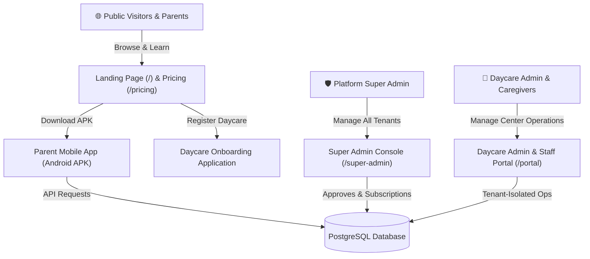
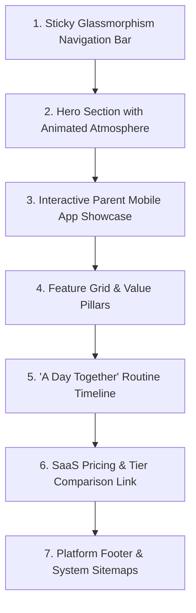
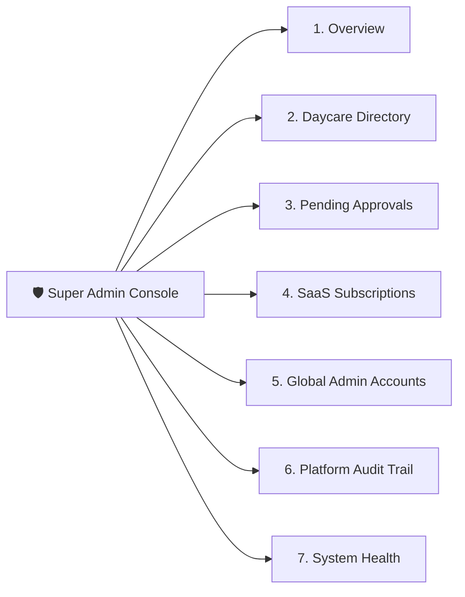

# Ankelba Platform — Landing Page & Super Admin Console Guide 🌐🛡️

> Comprehensive technical and operational documentation covering the **Public Landing Page** and the **Platform Super Admin Console** for the Ankelba Multi-Tenant Daycare Management Ecosystem.

---

## 📑 Table of Contents
1. [Architecture & Ecosystem Overview](#-architecture--ecosystem-overview)
2. [Session Isolation & Security Boundaries](#-session-isolation--security-boundaries)
3. [The Public Landing Page (`/`)](#-the-public-landing-page-)
   - [Purpose & Target Audiences](#purpose--target-audiences)
   - [Visual Layout & Key Components](#visual-layout--key-components)
   - [Public Navigation & Action Triggers](#public-navigation--action-triggers)
   - [Interactive App Showcase & Nursery Atmosphere](#interactive-app-showcase--nursery-atmosphere)
   - [SaaS Onboarding Flow for Daycares](#saas-onboarding-flow-for-daycares)
4. [The Super Admin Console (`/super-admin`)](#-the-super-admin-console-super-admin)
   - [Role & Responsibilities](#role--responsibilities)
   - [Operator Authentication & Credentials](#operator-authentication--credentials)
   - [Overview & Telemetry Dashboard](#1-overview--telemetry-dashboard)
   - [Daycare Centers Directory & Tenant Governance](#2-daycare-centers-directory--tenant-governance)
   - [Daycare Applications & Onboarding Review](#3-daycare-applications--onboarding-review)
   - [SaaS Subscriptions, Packages & Billing](#4-saas-subscriptions-packages--billing)
   - [Global Admin Accounts & Governance](#5-global-admin-accounts--governance)
   - [Platform Audit Trail & Privacy Safeguards](#6-platform-audit-trail--privacy-safeguards)
   - [System Health & Infrastructure Telemetry](#7-system-health--infrastructure-telemetry)
5. [Route Map & URLs](#-route-map--urls)
6. [Key Files & Code References](#-key-files--code-references)

---

## 🏛️ Architecture & Ecosystem Overview

Ankelba is a multi-tenant platform designed to serve three core stakeholder groups with strict role boundaries:

---

## 🔒 Session Isolation & Security Boundaries

In accordance with **SRS FR-SUB-05** and **FR-UAM-03**, Ankelba enforces strict token and session isolation. The browser storage keys are physically separated to avoid cross-role contamination:

| Role / Surface | URL Path | Dedicated Storage Key | API Client Instance |
| :--- | :--- | :--- | :--- |
| **Platform Operator (Super Admin)** | `/super-admin` | `ankelba_operator_token` | `operatorApi` ([portal/api.ts](file:///c:/Users/Mistire/Desktop/final%20year%20project/frontend/src/portal/api.ts)) |
| **Daycare Admin & Caregivers** | `/portal`, `/admin`, `/staff` | `ankelba_portal_token` | `portalApi` ([portal/api.ts](file:///c:/Users/Mistire/Desktop/final%20year%20project/frontend/src/portal/api.ts)) |
| **Parents / Guardians** | `/app`, `/parent`, Mobile APK | `ankelba_auth_token` | `apiClient` ([api/client.ts](file:///c:/Users/Mistire/Desktop/final%20year%20project/frontend/src/api/client.ts)) |

> [!IMPORTANT]
> The Super Admin console **never** reads or writes `ankelba_portal_token` or `ankelba_auth_token`. If an operator logs out or switches accounts, only `ankelba_operator_token` is cleared.

---

## 🌐 The Public Landing Page (`/`)

The Landing Page is the public gateway for the entire platform, accessible at `https://ankelba.pro.et/` or `http://localhost:8081/`.

### Purpose & Target Audiences
1. **Parents Seeking Quality Daycare:** Introduces Ankelba’s core promise: peace of mind through real-time milestone tracking, meal and nap logs, biometric pickup verification, and 24/7 AI pediatric guidance.
2. **Daycare Owners & Directors:** Showcases Ankelba as a turn-key SaaS solution to digitize attendance, billing, classroom management, and regulatory compliance.
3. **Academic & Industry Evaluators:** Displays the architectural sophistication, modern UI/UX design tokens, and technical excellence of the senior project.

### Visual Layout & Key Components

1. **Navigation Bar (`PublicNavMenu.web.tsx`):**
   * **Brand Emblem:** High-resolution Ankelba emblem with the tagline *"NURTURE • CONNECT • SAFEGUARD"*.
   * **Anchor Links:** Smooth-scrolling links to `#why-ankelba`, `#features`, `#a-day-together`, and `/pricing`.
   * **Direct Action Buttons:**
     * **Sign In:** Directs to `/portal` for daycare administrators and staff.
     * **Get Started:** Directs daycare owners to `/pricing` to register their facility.

2. **Hero Atmosphere (`HeroAtmosphere.web.tsx` & `NurseryBackdrop`):**
   * Playful, subtle SVG animations (floating sun, nursery clouds, gentle rainbow arches, building blocks, and twinkling stars).
   * High-impact headline: *"Every milestone, meal, and moment — safely connected."*
   * Primary Action: **"Explore Platform"** / **"Download Parent APK"**.

3. **Interactive Mobile App Showcase (`AppShowcase.web.tsx`):**
   * Renders realistic mobile viewport mockups showing:
     * Live daily activity feeds (meals, naps, potty logs, photos).
     * The AI Parent Guide interface.
     * Guardian pickup badge with biometric verification indicators.

4. **Why Ankelba / Feature Pillars:**
   * **Instant Peace of Mind:** Real-time push updates on feeding and developmental milestones.
   * **Biometric Child Protection:** Hardware-backed optical fingerprint and adult verification at checkout.
   * **Caregiver Efficiency:** Eliminates paper logbooks; attendance and billing take under 2 minutes per day.
   * **Integrated Digital Store:** Safe ordering of uniforms, diapers, and classroom materials with Chapa payments.

5. **Daycare Registration & Pricing Section:**
   * Highlights the Free Trial (14-day full access) and tiered plans (`Standard` vs `Enterprise`).
   * One-click transition to the self-service daycare registration wizard.

---

## 🛡️ The Super Admin Console (`/super-admin`)

The Super Admin Console is the central control plane for platform operators, accessible at `https://ankelba.pro.et/super-admin` or `http://localhost:8081/super-admin`.

### Role & Responsibilities
The Super Admin is **NOT** a daycare employee. The Super Admin is the **Platform Operator** who oversees:
* Daycare business licenses, verification, and tenant lifecycle (approval, activation, suspension).
* Platform SaaS subscriptions, billing packages, and automated payment verification.
* System-wide infrastructure health, database performance, and security compliance.
* Tenant isolation enforcement and privacy governance.

### Operator Authentication & Credentials
* **Login Path:** `/super-admin` (displays operator login modal if unauthenticated).
* **Default Development Operator:**
  * **Email:** `operator@ankelba.dev` (or platform owner account)
  * **Storage:** Persisted strictly in `localStorage.ankelba_operator_token`.
  * **API Authorization:** Sent as `Authorization: Bearer <operator_token>` on all `/api/super-admin/*` and `/api/saas/*` endpoints.

---

### Key Super Admin Modules

The Super Admin Console is organized into 7 dedicated administrative views:

#### 1. Overview & Telemetry Dashboard (`overview`)
* **KPI Metrics Cards:**
  * Total Registered Daycares & Active Centers.
  * Pending Daycare Applications requiring verification.
  * Active Trials vs. Active Paid Subscriptions.
  * Overdue or expiring subscriptions.
  * Total Platform Enrollment (system-wide active children count).
* **Quick Action Controls:**
  * Create New Daycare Tenant directly.
  * Instant access to pending applications.
  * System health quick-indicator badge.

#### 2. Daycare Centers Directory & Tenant Governance (`daycares`)
* **Tenant Search & Filtering:** Filter by center name, slug, status (`active`, `pending`, `suspended`, `rejected`), or subscription plan.
* **Per-Daycare Profile Data:**
  * Center Name, Subcity/Address, Contact Email & Phone.
  * Business License / Registration Number (e.g. `AA-EDU-2026-001`).
  * System Administrator name & account.
  * Active student enrollment vs. maximum package capacity (e.g., `2 / 100 active students`).
* **Operational Actions:**
  * **Approve / Activate:** Instantly promotes a newly onboarded daycare to active status.
  * **Suspend Center:** Temporarily freezes daycare staff access (e.g., for non-payment or compliance investigation).
  * **Reactivate Center:** Restores suspended daycare access.
  * **Adjust Capacity / Plan:** Modify maximum allowable enrolled children.

#### 3. Daycare Applications & Onboarding Review (`applications`)
* Handles incoming requests from daycare centers that registered through the public website.
* Operator verifies government accreditation and school permits before approving.
* Upon approval, the daycare tenant schema is provisioned and the primary Daycare Admin account is activated.

#### 4. SaaS Subscriptions, Packages & Billing (`subscriptions`)
* **Tiered Subscription Plans:**
  * **14-Day Free Trial:** Full feature access, capped at 25 children.
  * **Standard Plan:** Full daily reports, attendance, messaging, capped at 100 children.
  * **Enterprise / Unlimited:** Multi-branch support, biometric hardware sync, custom reporting.
* **Payment Processing & Ledger:**
  * Tracks payment cycles (Monthly / Quarterly / Annually).
  * Verifies digital payments made via Chapa or Telebirr bank transfers.
  * Automatic **3-Day Pre-Due Reminder**: Alerts daycare administrators 3 days before their subscription period expires.
  * Overdue Handling: Grace period management before automatic tenant suspension.

#### 5. Global Admin Accounts & Governance (`users`)
* **Privacy-Conscious User Management:**
  * In compliance with student and family privacy regulations, this view **strictly displays Daycare Administrator accounts only** (along with the daycare they administer).
  * Does **NOT** expose personal parent records, children's home addresses, or caregiver accounts to platform operators.
* **Administrator Actions:**
  * Force password reset for locked-out daycare administrators.
  * Revoke or reactivate daycare admin login privileges.

#### 6. Platform Audit Trail & Privacy Safeguards (`audit`)
* **What is Logged:**
  * Daycare registrations, license approvals, and status transitions.
  * Subscription upgrades, renewals, and cancellations.
  * Payment verification and manual financial adjustments.
  * Operator logins and security policy modifications.
* **Privacy Boundary:**
  * Daily child check-ins, diaper logs, and parent-caregiver chat messages are kept strictly inside the daycare tenant boundary and are **never** dumped into the platform audit log.

#### 7. System Health & Infrastructure Telemetry (`health`)
* **Live System Metrics:**
  * PostgreSQL Database Connection & Query Latency (`db_latency_ms`).
  * Database Storage Footprint & Table Row Counts.
  * Node.js Runtime Version and Host Uptime.
  * Security State Checklist: Tenant Isolation Status, RBAC Enforcement, and Biometric Hardware Gateway status.

---

## 🗺️ Route Map & URLs

| Route | Role / Accessibility | Purpose |
| :--- | :--- | :--- |
| `/` | Public | Public landing page, features, mobile showcase |
| `/pricing` | Public | SaaS pricing tiers & daycare registration wizard |
| `/super-admin` | Platform Operator Only | Cross-tenant governance & subscription management |
| `/portal` | Daycare Admin & Caregivers | Daily daycare management portal |
| `/app` | Parents & Guardians | Parent web app / mobile portal redirect |

---

## 📁 Key Files & Code References

### Landing Page
* [LandingPage.web.tsx](file:///c:/Users/Mistire/Desktop/final%20year%20project/frontend/src/landing/LandingPage.web.tsx) — Main landing page composition and section scrolling.
* [HeroAtmosphere.web.tsx](file:///c:/Users/Mistire/Desktop/final%20year%20project/frontend/src/landing/HeroAtmosphere.web.tsx) — Nursery atmosphere animations and hero backdrop.
* [AppShowcase.web.tsx](file:///c:/Users/Mistire/Desktop/final%20year%20project/frontend/src/landing/AppShowcase.web.tsx) — Interactive mobile phone UI preview.
* [PublicNavMenu.web.tsx](file:///c:/Users/Mistire/Desktop/final%20year%20project/frontend/src/landing/PublicNavMenu.web.tsx) — Navigation bar with portal access buttons.
* [LandingFooter.web.tsx](file:///c:/Users/Mistire/Desktop/final%20year%20project/frontend/src/landing/LandingFooter.web.tsx) — Academic attribution, sitemaps, and direct links.
* [landing.css](file:///c:/Users/Mistire/Desktop/final%20year%20project/frontend/src/landing/landing.css) — Custom responsive styling and design tokens.

### Super Admin Console
* [SuperAdmin.web.tsx](file:///c:/Users/Mistire/Desktop/final%20year%20project/frontend/src/portal/SuperAdmin.web.tsx) — Complete operator console, state management, and tab views.
* [SubscriptionViews.web.tsx](file:///c:/Users/Mistire/Desktop/final%20year%20project/frontend/src/portal/SubscriptionViews.web.tsx) — SaaS subscription ledger, packages, and payment verification.
* [api.ts (operatorApi)](file:///c:/Users/Mistire/Desktop/final%20year%20project/frontend/src/portal/api.ts) — Isolated operator API client utilizing `ankelba_operator_token`.
* [auditUtils.ts](file:///c:/Users/Mistire/Desktop/final%20year%20project/frontend/src/portal/auditUtils.ts) — Formatting and classification for platform audit events.
* [saas.css](file:///c:/Users/Mistire/Desktop/final%20year%20project/frontend/src/portal/saas.css) — Operator console and subscription management stylesheet.

