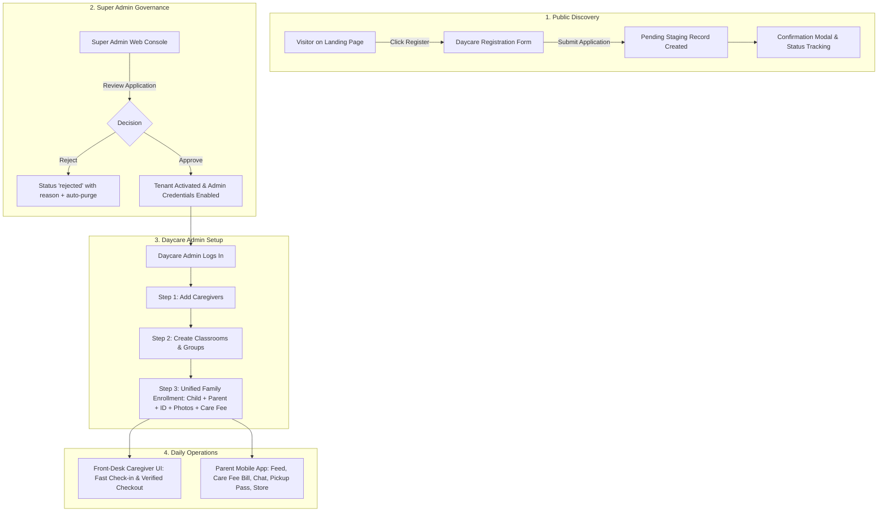

# Ankelba Daycare Platform — Brainstorming Session 1 (Refined)

**Date:** 25 October 2026  
**Project:** Ankelba — Parent Communication and Child Activity Reporting Platform for Daycare Centers  
**Document Purpose:** Finalized consensus on the simplified user journeys, streamlined daycare onboarding (no pricing barrier), realistic daycare fee management, role-based UI separation, and dedicated folder structure.

---

## 1. Core Architectural Consensus

1. **No Pricing Page / No Trial Hurdles:**
   - Daycares are on a direct adoption journey: Public Landing Page ➔ Click "Register" ➔ Direct Daycare Registration Form.
   - No confusing pricing tiers or automated SaaS billing. The focus of the project is daycare child care and parent communication.
   - When submitted, the application enters a staging state (`pending`).
   - When Super Admin approves, the Daycare is immediately `active` and ready for setup.

2. **Landing Page Value Proposition:**
   - Premium, stunning visual aesthetics using Ankelba’s brand identity (Warm cream `#FFFBED`, deep navy `#061224`, pastel semantic accents, Quicksand typography, glassmorphism cards).
   - Showcases **"Why Daycares Need Ankelba"**:
     - *For Daycare Owners:* Organized child rosters, staff attendance duty, simplified care fee tracking, verified safety.
     - *For Caregivers:* Fast front-desk check-in/checkout, zero paperwork.
     - *For Parents:* Peace of mind, real-time child activity updates, direct office chat, verified child pickup.
   - Includes Features showcase, Testimonials, About, and Contact.

3. **Realistic Daycare Finance Model (Child Care Fees, Not "School Tuition"):**
   - Daycares are childcare and early development centers; they do not charge formal academic school tuition.
   - Instead, daycares manage:
     1. **Monthly/Weekly Child Care Fee (የአገልግሎት ክፍያ):** Fixed periodic fee for child care and stay.
     2. **Registration / Enrollment Fee (የምዝገባ ክፍያ):** One-time onboarding charge.
     3. **Daycare Supplies & Items (የዕቃዎች ክፍያ):** Diapers, hygiene items, extra snacks, daycare t-shirts (from the daycare store).
   - This directly links to the **Child Profile** and the **Daycare Store**.
   - Parents view their child's monthly care bill and store orders in their mobile app.
   - Admin records payments (Cash at Daycare or Telebirr/Bank transfer reference) and issues digital receipts.

4. **Dedicated Front-Desk Caregiver Workspace:**
   - Dedicated exclusively to **Attendance Checking & Child Pickup / Checkout**.
   - Fast, touch-friendly, rapid action buttons so caregivers can check children in and verify authorized adult guardians on release without getting bogged down in complex navigation.

---

## 2. End-to-End User Journeys



---

## 3. Dedicated Folder & Application Separation

To give each interface a tailored experience without mixing desktop administrative code with mobile touch code:

```
final-year-project/
├── backend/                       # Shared Node.js/Express + PostgreSQL REST API
│   ├── src/
│   │   ├── modules/               # Auth, children, attendance, finance, store, etc.
│   │   ├── db/migrations/         # Row-Level Security migrations
│   │   └── middleware/            # Tenant isolation & security
│   └── backend documentation/     # Specifications and architecture docs
│
├── landing-page/                  # Standalone Public Web Showcase
│   ├── index.html / src/          # Hero, "Why Ankelba", Features, Testimonials, About, Contact
│   └── registration/              # Public Daycare Registration Form & Status Popup
│
├── web-portal/                    # Desktop Management Applications
│   ├── super-admin/               # Platform Operator Console
│   │   └── (Approve/Reject Daycare Applications, Tenant Census, Global Audit)
│   ├── admin/                     # Daycare Admin Operational Dashboard
│   │   ├── dashboard/             # Overview metrics & daily roster status
│   │   ├── staff/                 # Caregiver provisioning & duty assignments
│   │   ├── classrooms/            # Class & age-group management
│   │   ├── enrollment/            # Unified Family Form (Parent, Child, Photos, ID Card, Care Fee)
│   │   ├── finances/              # Child Care Fees, Invoices, Payment Receipts
│   │   ├── store/                 # Daycare supplies inventory & order fulfillment
│   │   └── audit/                 # Daycare operational logs
│   └── caregiver/                 # Front-Desk Terminal UI
│       └── (Fast child check-in, attendance sheet, authorized guardian pickup verification)
│
└── mobile-app/                    # React Native / Expo Mobile App (Dedicated to Parents)
    ├── src/
    │   ├── feed/                  # Today's real-time timeline & activity alerts
    │   ├── reports/               # Full daily care history (meals, rest, activities)
    │   ├── finances/              # My Child's Bill (Care fee + store items, receipts)
    │   ├── pickup/                # Digital Pickup Pass & Authorized Guardians status
    │   ├── chat/                  # Direct messaging with daycare front desk
    │   └── store/                 # Order daycare supplies for the child
```

---

## 4. Staging Architecture for Daycare Applications

To prevent unapproved applications from polluting primary database tables:

1. **Submission:**
   - Writes strictly to `daycare_applications` table with status `'pending'`.
   - Captures: Daycare Name, City/Subcity, Phone, Email, License Number, Admin Name, Admin Email, Password Hash.
   - Does **not** insert into `daycares` or `users`.
2. **Super Admin Review:**
   - **Approval:** A database transaction atomically:
     - Creates `daycares` row (`status = 'active'`).
     - Creates `users` row (`role = 'admin'`, tied to the new `daycare_id`).
     - Marks `daycare_applications` as `'approved'`.
   - **Rejection:**
     - Sets `status = 'rejected'` and saves `rejection_reason`.
     - No rows are created in `daycares` or `users`.
     - Scheduled cron purges rejected applications older than 30 days.

---

## 5. Child Care Fee & Expense Management Workflow

### How it works:
1. **Setting Care Fee at Enrollment:**
   - When the Daycare Admin registers a child in the Unified Family Enrollment form, they specify the child's **Monthly Care Fee** (e.g., 3,500 ETB/month) and any initial **Registration Fee**.
2. **Monthly Billing Cycle:**
   - At the beginning of the month, the system generates a care fee invoice for each active enrolled child.
   - If the parent purchases supplies from the Daycare Store (e.g., diapers, formula), the order amount is linked to the child's balance.
3. **Payment Reconciliation:**
   - Parent views the invoice in their mobile app under **"Fees & Payments"**.
   - Parent can:
     - Pay in cash at the daycare office.
     - Transfer via Telebirr/CBE and enter the transaction reference number.
   - Daycare Admin clicks **"Record Payment"** on the web portal to mark it paid and print a digital receipt.


---

## 6. Phase 2 Implementation & Verification Summary (Completed)

### 1. Database Schema & Multi-Tenancy (038_child_care_fees_and_invoices.js)
- children.monthly_care_fee: Baseline monthly care fee (default: ETB 3,500.00).
- child_invoices: Invoicing with idempotency constraint on (daycare_id, child_id, billing_period, invoice_type).
- child_payments: Multi-method payments (Cash at desk, Telebirr, CBE) with immutable digital receipt generation (REC-YYYYMMDD-XXXX).
- Multi-tenant RLS isolation and grants configured for ankelba_tenant.

### 2. Backend Modules & Endpoints (backend/src/modules/finances/)
- GET /api/finances/overview: Real-time financial KPIs (Total Collected, Billed, Outstanding, Overdue, Collection Rate).
- GET /api/finances/invoices: Filterable invoice list by status, month, child, search.
- GET /api/finances/invoices/:id: Detailed breakdown with payment ledger.
- POST /api/finances/invoices/generate-monthly: Idempotent batch monthly billing.
- POST /api/finances/invoices/:id/payments: Payment recording and digital receipt issuance.
- GET /api/finances/parent/my-bills: Parent bills and receipt history.

### 3. Frontend Daycare Admin Portal (frontend/src/portal/DaycareFinances.web.tsx)
- Integrated into Portal.web.tsx under YOUR DAYCARE -> Finances & Fees.
- KPI summary cards with collection rate badges.
- Search and filter bar (All, Pending, Partially Paid, Paid, Overdue).
- Generate Monthly Care Fees modal with period and fee customization.
- Record Payment modal with Cash / Telebirr / CBE payment options.
- Digital Receipt (ሕጋዊ ደረሰኝ) view modal with print/save capability.

### 4. Verification & Test Results
- test_finances_flow.js: 15/15 tests passed (100%).
- test_lifecycle_e2e_full.js: 35/35 invariants passed (100%).
- test_swt_comprehensive.js: 26/26 tests passed (100%).
- TypeScript Typecheck (npx tsc --noEmit): 0 errors.
- Live browser verification: Passed with visual confirmation.
