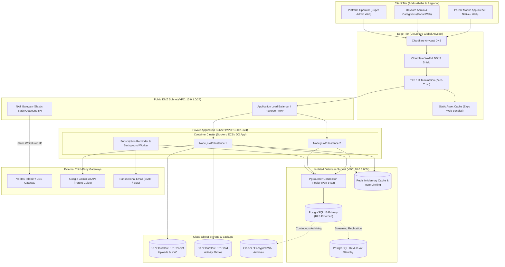
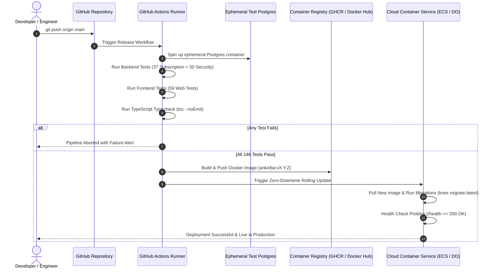

# Ankelba Cloud Architecture Blueprint
**Platform:** Ankelba — Multi-Tenant SaaS Daycare Management & Child Activity Reporting  
**Institution:** HiLCoE School of Computer Science and Technology  
**Authors:** Senior Project Engineering Team  
**SRS Baseline:** v1.2 (`Ankelba_SRS_AI_Readable.md`)  
**Status:** Architecture Blueprint for Production & Senior Project Defense  

---

## 1. Executive Cloud Strategy & Objectives

The Ankelba platform transitions from local development to a cloud-native, secure, and resilient SaaS architecture. Because Ankelba handles sensitive child identity data, real-time guardian biometric pickup validations, and electronic payments (Telebirr, CBE, Bank of Abyssinia), its cloud topology must adhere to strict security, compliance, and availability benchmarks:

1. **Zero-Leakage Multi-Tenancy**: Kernel-enforced PostgreSQL Row-Level Security (RLS) preserved in the cloud via connection multiplexing.
2. **Sovereign Payment Gateway Egress**: Reliable outbound connectivity to Veritas endpoints with static egress IPs for Telebirr and CBE verification.
3. **Low-Latency Edge Delivery**: Sub-100ms asset delivery to parents and daycare staff in Addis Ababa and regional Ethiopian hubs via localized CDNs.
4. **Disaster Recovery & Data Durability**: Continuous Write-Ahead Log (WAL) streaming with Point-In-Time Recovery (PITR) to S3-compatible cold storage.
5. **Cost-Effective Scalability (FinOps)**: Staged scaling strategy starting from a **$25/month pilot** to a multi-AZ enterprise cluster.

---

## 2. High-Level Architecture Topology

---

## 3. Network & Infrastructure Tier Breakdown

### 3.1 Edge Security Tier (Cloudflare Anycast)
- **DDoS Mitigation**: Unmetered Layer 3/4 and Layer 7 protection.
- **Web Application Firewall (WAF)**: Rulesets inspecting incoming HTTP payloads for SQL injection, path traversal, and malicious headers before reaching the origin.
- **SSL/TLS 1.3**: Automatic SSL provisioning with HSTS (HTTP Strict Transport Security) enabled.
- **Edge Caching**: Expo web bundles, fonts (`Quicksand`), and UI assets cached at edge nodes closest to East Africa (e.g., Djibouti, Nairobi, Mombasa points of presence) reducing first-contentful paint (FCP) to under 800ms.

### 3.2 Ingress & Load Balancing Tier (DMZ Subnet)
- **Reverse Proxy**: Nginx or Cloud Load Balancer with strict HTTP rate limiting:
  - Global API: 120 requests / 15 minutes per IP.
  - Payment endpoints: 30 requests / 15 minutes.
  - Authentication endpoints: 5 attempts / 15 minutes with exponential backoff.
- **Static Egress NAT**: All outbound requests to the Veritas Telebirr/CBE API route through an Elastic IP / Cloud NAT Gateway, allowing banking partners to whitelist Ankelba's source IPs.

### 3.3 Containerized Application Tier (Private Subnet)
- **Stateless Node.js Instances**: Running containerized Express servers across multiple availability zones.
- **Health Checks**: `/health` probing database connectivity (`SELECT 1`) and memory pressure every 10 seconds.
- **Zero-Downtime Deployment**: Rolling updates or Blue/Green container swaps triggered by GitHub Actions CI/CD.

### 3.4 Data & Persistence Tier (Isolated Subnet)
- **PgBouncer Connection Pooling**:
  - Acts as an intermediary between Node.js and PostgreSQL.
  - Configured in **Transaction Pooling Mode** (`pool_mode = transaction`).
  - Supports up to 2,000 incoming parent connections multiplexed into 20–30 physical PostgreSQL server connections, solving the connection starvation problem.
- **Dual Role Enforcement**:
  - `ankelba_tenant_app`: Constrained by Row-Level Security (`FORCE ROW LEVEL SECURITY`).
  - `ankelba_control_app`: Constrained to SaaS governance, subscriptions, and audit tables.
- **Redis 7.x**:
  - Shared in-memory store for distributed API rate-limiting tokens.
  - Distributed locks for renewal and payment processing (`Redlock`).
  - Session invalidation blacklist for revoked JWT tokens.

---

## 4. Media Storage & Data Privacy Architecture

In compliance with SRS §2.6 (Child Information Sensitivity):
- **Child Photos & Daily Reports**: Stored in a private, non-public S3/R2 bucket. Never served via public static URLs. Access is mediated via pre-signed URLs with a 5-minute Time-To-Live (TTL), generated only after verifying the requesting parent's JWT link to that `child_id`.
- **Payment Receipts & OCR Evidence**: Stored in an encrypted bucket (`AES-256-GCM`), accessible only by authorized platform operators via `/super-admin/payment-intents/:id`.
- **Database Backups**: Nightly encrypted dumps created via `pg_dump` with symmetric GPG encryption, synced to off-site cloud storage per [`docs/BACKUP_RUNBOOK.md`](file:///c:/Users/Mistire/Desktop/final%20year%20project/docs/BACKUP_RUNBOOK.md).

---

## 5. Continuous Integration & Deployment (CI/CD)

---

## 6. Multi-Stage Cost & Scaling Plan (FinOps)

| Phase | Target Scope | Recommended Cloud Providers | Architecture Configuration | Estimated Monthly Cost |
| :--- | :--- | :--- | :--- | :--- |
| **Phase 1: Academic Pilot** | 3–10 Daycares (~300 Children) | **DigitalOcean / Render / Supabase** | - 1x App Container (1 vCPU, 2GB RAM) - Managed PostgreSQL (1 vCPU, 2GB, 25GB SSD) - Cloudflare Free Tier (CDN/WAF) - Cloudflare R2 (10GB Free Storage) | **$15 – $35 / mo** |
| **Phase 2: Commercial Launch** | 30–100 Daycares (~5,000 Children) | **AWS (eu-north-1 / af-south-1) or DigitalOcean** | - 2x App Containers with Auto-Scaling - Managed Postgres (2 vCPU, 4GB RAM, Multi-AZ) - Managed Redis (1GB) - AWS S3 + CloudFront - Elastic IP / NAT Gateway | **$110 – $190 / mo** |
| **Phase 3: National Platform** | 200+ Daycares (~25,000+ Children) | **AWS Enterprise Infrastructure** | - ECS Fargate Auto-Scaling Cluster (3–8 instances) - Amazon Aurora PostgreSQL (Multi-AZ Serverless v2) - PgBouncer Dedicated Layer - AWS WAF + Shield + KMS - S3 Intelligent Tiering + Glacier Archives | **$450 – $850 / mo** |

---

## 7. Summary of Architectural Advantages for Final Defense

1. **Security Compliance**: Separates public DMZ, application containers, and databases into isolated subnets with zero public database exposure.
2. **Scalability**: Decouples heavy file uploads (S3 pre-signed URLs) from Node.js event-loop threads.
3. **Resilience**: Introduces PgBouncer transaction pooling to eliminate connection exhaustion during morning drop-off spikes.
4. **Economic Feasibility**: Can be presented to the examination board as an affordable project that launches on a $25/mo budget and scales smoothly into a national childcare infrastructure.

