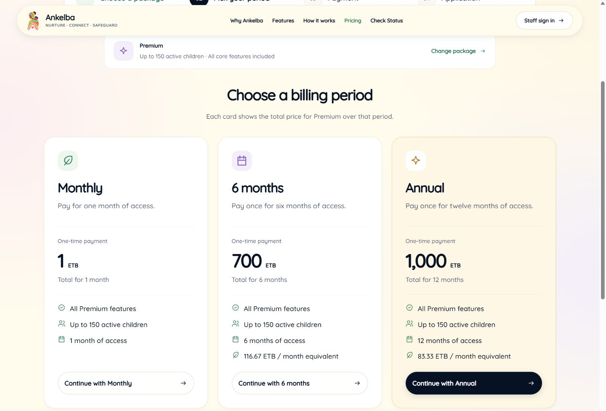

# Pricing verification — 8 November 2026

## Fix

Removed the active-payment “Change package / Start over” shortcut. It deleted the browser's recovery credentials without checking whether a transfer had already occurred. Active and confirmed sessions now remain recoverable. Changing plans before creating payment and restarting an expired/rejected session with acknowledgement and a fresh server-status check remain available.

## Verified

- 37 frontend checks passed: package-first selection, three period cards, configured totals and genuine savings, unavailable prices, payment methods, verification progress/errors, duplicate-submit protection, recovery, restart, application validation/submission and navigation.
- Six backend checks passed, including disposable-database paid signup, application approval, renewal, all three methods, strict matching and reference reuse prevention.
- TypeScript and the production web export passed after the final fix. Whitespace checks passed.
- Browser inspection at 1440px and 390px confirmed readable comparison/checkout layouts without horizontal overflow, the five mobile navigation links, Standard and Premium period choices, captured checkout totals, all three configured payment methods and required email validation.
- Restarted the local Expo server on port 8083 with its cache cleared. The previously open browser page had displayed an older checkout. Verification used the refreshed build.

No receiving accounts or prices were changed during this verification. No live payment, real receipt verification or real application was submitted. Genuine receipt verification remains a separate private test with the payment provider.

